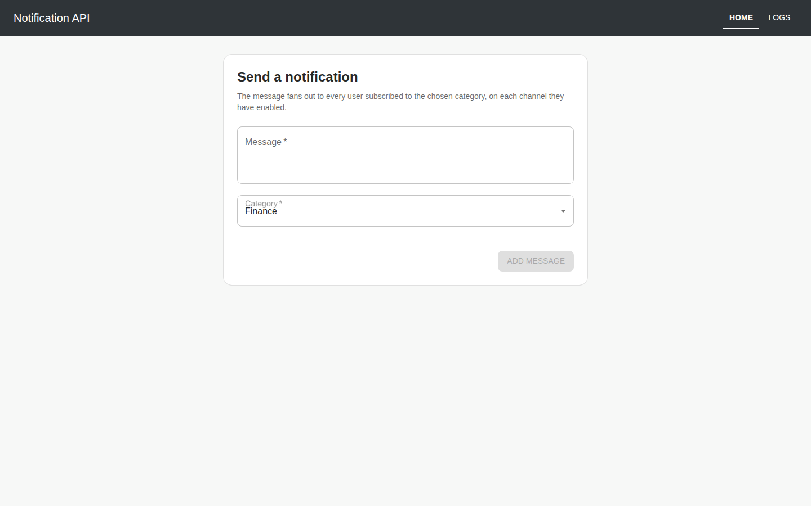
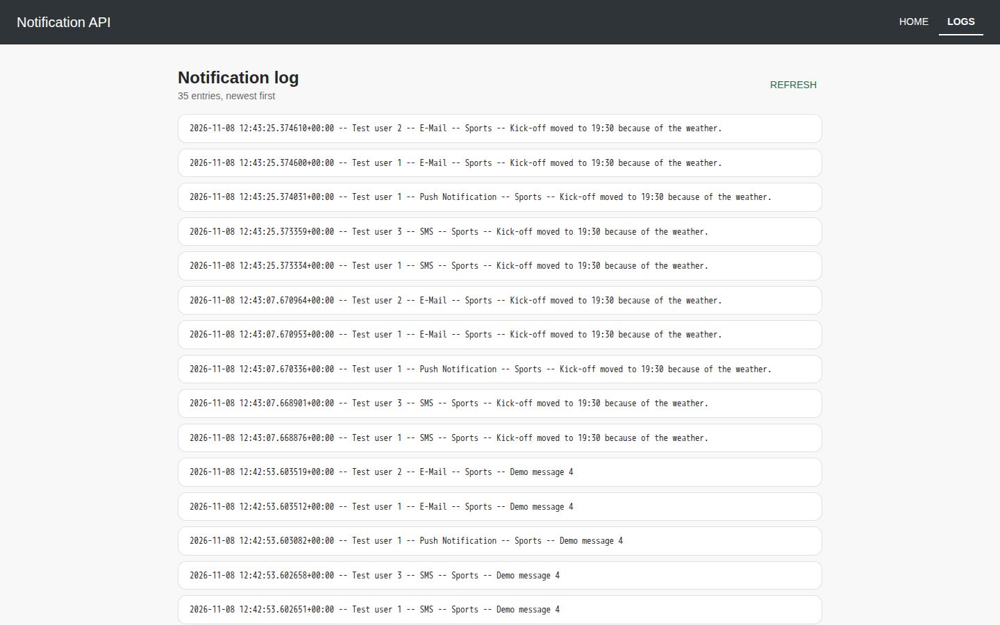
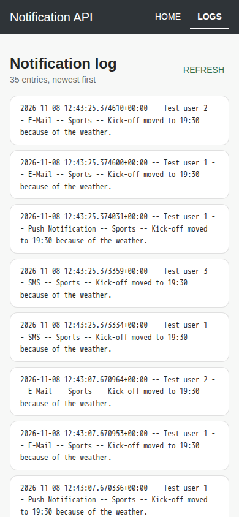

# code-samples

Three small Django REST Framework projects, each written for its own brief and
kept in one repository so they can be read side by side. They share no code, no
database and no settings module. Pick a directory and run it on its own.

| Directory | What it does | Tests |
|---|---|---|
| [`TradeCore/`](TradeCore/tradecore) | Social-posting API: sign up, log in with a JWT, create, edit, delete and like posts | 52 |
| [`aviyel/`](aviyel/aviyel_api) | Collects YouTube search results for a keyword into a CSV, then reports per-category counts, durations and tags | 29 |
| [`notification-app/`](notification-app) | Posts a message to a category and fans it out to every subscriber on every channel they use, with a React UI | 21 API + 16 UI |

The directory names come from the briefs the samples were written for. None of
the samples needs an API key, and no test makes a network call.

## Requirements

- Python 3.12 (pinned in [`.python-version`](.python-version)), one virtual
  environment per sample.
- Node 22 for the notification front-end (pinned in
  [`.nvmrc`](notification-app/notificationFrontend/.nvmrc)).
- Or just Docker, see [Running everything with Docker](#running-everything-with-docker).

Every backend has a `requirements.in` and a resolved `requirements.txt`, plus an
`.env.example`. Copying it to `.env` is optional, because every value has a
working default. The default `SECRET_KEY` is a placeholder for local use only.

## TradeCore: JWT social API

```bash
cd TradeCore/tradecore
python3.12 -m venv .venv && source .venv/bin/activate
pip install -r requirements.txt
python manage.py migrate
python manage.py test             # 52 tests
python manage.py runserver        # http://localhost:8000/api
```

Routes (no trailing slashes): `POST /api/signup`, `POST /api/login`,
`GET /api/user/<id>`, `GET|POST|PATCH /api/post`, `PATCH|DELETE /api/post/<id>`.
Authenticated calls send `Authorization: JWT <token>` with the token from login.

```console
$ curl -s -X POST localhost:8000/api/signup -H 'Content-Type: application/json' \
    -d '{"email":"ada@example.com","password":"a-Strong-passw0rd","first_name":"Ada","last_name":"Lovelace"}'
{"id":1,"email":"ada@example.com","first_name":"Ada","last_name":"Lovelace","geolocation_data":{},"joined_on_holiday":false}
```

The full path, including login, likes and the 401 cases, is in
[`TradeCore/docs/api-walkthrough.md`](TradeCore/docs/api-walkthrough.md).

Design notes:

- **Tokens.** `utils/account_utility.py` issues and checks tokens with PyJWT:
  HS256 only, signed with `SECRET_KEY`, and `exp`, `iat` and `email` are
  required. The tests cover expired tokens, tokens without an expiry and tokens
  signed with another algorithm.
- **Ownership.** The post owner is always the caller. It cannot be changed
  through `PATCH /api/post/<id>`, and only the owner can edit or delete a post.
- **Optional enrichment.** At signup two Abstract API lookups can record the
  caller's geolocation and whether the day is a public holiday. Without
  `ABSTRACT_GEOLOCATION_API_KEY` / `ABSTRACT_HOLIDAYS_API_KEY` they are skipped,
  not attempted.
- **Bounded listing.** `GET /api/post` returns at most 100 posts, newest first,
  in two queries however many posts exist.

## aviyel: YouTube keyword analysis

```bash
cd aviyel/aviyel_api
python3.12 -m venv .venv && source .venv/bin/activate
pip install -r requirements.txt
python manage.py test             # 29 tests
python manage.py runserver
curl 'http://localhost:8000/analysis/?keyword=travel'
```

`POST /analysis/ {"keyword": "..."}` collects videos into
`aviyel_api/input_files/<keyword>.csv`, which needs `GOOGLE_API_KEY`. Without
it the endpoint returns 503 and names the variable. `GET /analysis/?keyword=...`
reads that file, needs no key, and writes five report CSVs to `output_files/`:

```console
{"message":"Analysis complete for 'travel'.","videos_analysed":350,"categories":15,
 "files":["number_of_videos.csv","min_max_tag_videos.csv","average_durations.csv",
          "min_max_tag_durations.csv","classified_tags.csv"]}
```

The report contents are in [`aviyel/docs/analysis-run.md`](aviyel/docs/analysis-run.md).

Design notes:

- **Three layers.** `services/youtube.py` makes every network call,
  `services/statistics.py` is plain pandas with no Django or HTTP, and
  `views.py` only handles HTTP. That split is what lets the tests run offline.
- **Batched collection.** Video details and category names are requested 50
  ids per call, so 120 videos cost three `videos.list` calls, not 120.
- **The committed `travel.csv` is not a clean travel sample.** An early bug
  searched the keyword on the first page only, so just 29 of its 350 rows are
  `Travel & Events`. It is kept as input for the analysis code because
  regenerating it needs a key.

## notification-app: fan-out on write

A message is posted to a category. In one transaction, the API writes one `Log`
row for each user who subscribes to that category, for each channel the user
has enabled. Nothing is really sent: every dispatcher writes a log row, and no
SMS or e-mail provider sits behind it.

```bash
# API
cd notification-app/notificationAPI
python3.12 -m venv .venv && source .venv/bin/activate
pip install -r requirements.txt
python manage.py migrate
python manage.py seed_demo --messages 4    # 3 channels, 3 categories, 3 users
python manage.py test                      # 21 tests
python manage.py runserver

# front-end, in a second terminal
cd notification-app/notificationFrontend
npm ci && npm start                        # http://localhost:3000
npm run test:once                          # 16 tests
```





The log page at phone width:



Routes: `GET /logs/` and `GET /logs/string` (paginated, `{count, results}`),
`POST /add/`, `GET /categories/`. The form loads its categories from the API,
and the log page shows the newest page together with the total count.

Design notes:

- **Adding a channel is a subclass.** `NotificationDispatcher.dispatchers()` in
  `main/notifications.py` walks the subclass tree, so a new channel needs no
  registration call and no change to the manager:

  ```python
  class WebhookDispatcher(NotificationDispatcher):
      channel_name = "Webhook"
  ```

- **Constant query count.** `GET /logs/` uses `select_related` across user,
  channel, message and category, and a test holds it at two queries for both
  4 and 44 rows.
- **No queue.** The fan-out runs inside the request. That is fine for a demo
  and wrong for real delivery.

More detail, including the endpoint table and front-end configuration, is in
[`notification-app/README.md`](notification-app/README.md).

## Running everything with Docker

[`docker-compose.yml`](docker-compose.yml) builds all four services and
publishes them on host ports 8611 to 8614:

```bash
docker compose up --build              # all four
docker compose up --build tradecore    # or just one
```

| tradecore | aviyel | notification-api | notification-frontend |
|---|---|---|---|
| [8611](http://localhost:8611/api/) | [8612](http://localhost:8612/analysis/?keyword=travel) | [8613](http://localhost:8613/logs/) | [8614](http://localhost:8614) |

The TradeCore and notification containers run their migrations on start and
keep SQLite on a named volume. The notification API also seeds its demo
channels, categories and users, so the front-end on 8614 works straight away.
To add demo messages:

```bash
docker compose exec notification-api python manage.py seed_demo --messages 4
```

## Configuration

| Sample | Variables (all optional) |
|---|---|
| TradeCore | `SECRET_KEY`, `DJANGO_DEBUG`, `ALLOWED_HOSTS`, `SQLITE_PATH`, `ABSTRACT_GEOLOCATION_API_KEY`, `ABSTRACT_HOLIDAYS_API_KEY`, `ABSTRACT_API_TIMEOUT` |
| aviyel | `SECRET_KEY`, `DJANGO_DEBUG`, `ALLOWED_HOSTS`, `GOOGLE_API_KEY` (collection only) |
| notification API | `SECRET_KEY`, `DJANGO_DEBUG`, `ALLOWED_HOSTS`, `SQLITE_PATH`, `CORS_ALLOWED_ORIGINS`, `PAGE_SIZE` |
| notification front-end | `REACT_APP_API_URL` (default `http://localhost:8000/`) |

## Formatting and lint

The repository root holds the only shared files. None of them is code:
[`pyproject.toml`](pyproject.toml) (black, isort), [`setup.cfg`](setup.cfg)
(pycodestyle) and `.editorconfig`. They cover all three samples:

```bash
black --check . && isort --check-only . && pycodestyle .
```

The front-end uses CRA's ESLint config (`npx eslint src`) and Prettier.

## Limits

- SQLite and `runserver` everywhere. These are samples to read, not
  deployments.
- aviyel loads the whole CSV into memory, which is fine for a few hundred rows.
- `GET /api/user/<id>` in TradeCore needs no token, so it shows any user's
  e-mail address.

## License

[MIT](LICENSE).
